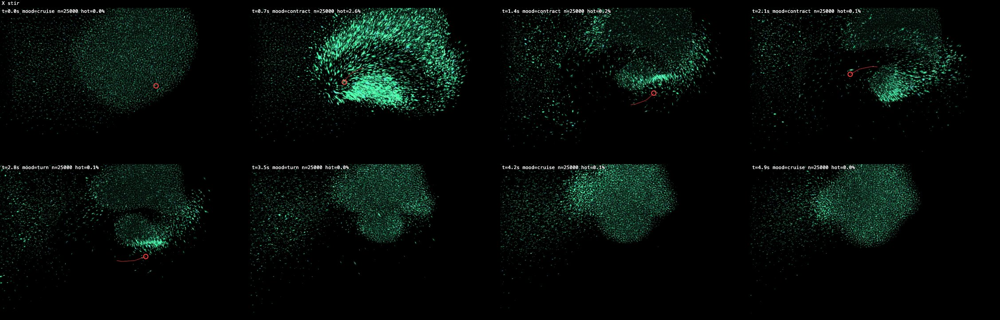

# bioluminescent school

A living school of 25,000 bioluminescent, fish-like particles, simulated
entirely in WebGPU compute and drawn as in-hue light: it travels, turns,
mills, startles and collapses in on itself without any input. It is the
background of [olle.work](https://olle.work), and your cursor is the
predator.



*A cursor stir through the school, 12 frames 0.65 s apart (the red ring is
the cursor): the school parts, bolts, then collapses back into one body.*

**Live:** <https://bioluminescent-gpu-next.vercel.app> (a preview deploy
for now). Needs a browser with WebGPU for the full school; anything else
falls back to the CPU engine with a few thousand fish.

It began as a rewrite of [bioluminescent-swarm](https://bioluminescent.vercel.app)
(v3, ~2,600 particles on the CPU with three.js). The behavior contract for
the port, [`docs/HANDOFF-GPU.md`](docs/HANDOFF-GPU.md), defines what had to
survive: four behavior layers, eight dynamical invariants, and a taste law
(glow stays in the palette's hue and never goes white; movement comes
before light).

## Run

```
npm install
npm run dev        # http://localhost:5209
npm run typecheck
npm run build      # static bundle in dist/
```

No runtime dependencies on the GPU path; three.js is lazy-loaded only for
the CPU fallback.

## Controls

- **Move the pointer** through the school to hunt it; a fast flick from
  rest is a *strike*. **Click** sets off a light cascade.
- **D** opens the dev panel: presets, palettes, every slider, mood pins,
  and *Save feel…*.
- **1–9** switch between feels (`snapshots/*.json`) in place, without
  resetting the school.
- URL parameters: `?feel=<name>` boots a feel (default `olle-work`, the
  shipped one; `site-default` is the v3 state), `?backend=cpu` forces the
  fallback, `?count=N` overrides the particle count (default 25,000 on
  desktop, 12,000 on touch devices). A hidden tab stops simulating;
  `?alive=1` keeps it running for test and agent panes that report hidden
  (the filmstrip tool does this for itself).

## Architecture

```
src/
  params.ts        shared spec: sliders, palettes, TUNING (v3 verbatim) + GPU_TUNING
  presets.ts       v3 preset matrix
  system.ts        SwarmSystem: the interface both backends implement
  feel.ts          named feels (snapshots/*.json), keys 1–9, ?feel=
  main.ts          boot: WebGPU detect → gpu/ ; else lazy-load cpu/ (three.js chunk)
  governor.ts      adaptive count governor (GPU and CPU meters)
  harness.ts       acceptance probes (async, backend-agnostic)
  review.ts        filmstrip contact sheets for visual review
  DevPanel.ts      the dev panel
  gpu/             the rewrite: no three.js, no dependencies
    GpuSwarm.ts    host side: director FSM, event queue, uniforms, buffers
    wgsl-sim.ts    grid build, event resolve, sim kernel, reductions (WGSL)
    wgsl-render.ts instanced sprites + hue-preserving tonemap (WGSL)
    renderer.ts    HDR pipeline, canvas, brightness budget
    camera.ts      fixed camera + pointer unprojection
  cpu/             the v3 engine carrying every GPU lever, + a three.js adapter
                   with the same HDR target and hue-preserving resolve
```

**Split.** Whole-school state stays on the host, as HANDOFF §2.2
prescribes: the mood FSM (cruise/turn/mill/hover/startle/contract), shared
heading, roam anchor, pointer kinematics and spontaneous-flash scheduling
are a handful of scalars per frame, written into one uniform buffer.
Everything per-particle lives in GPU storage buffers and never crosses
back, except one small async readback (centroid, flock count, mean fear,
debug stats), 1–2 frames stale, which matches the CPU version's "last
frame's centroid" semantics.

**Frame anatomy** (one compute pass): clear grid → count → prefix-scan →
scatter (a counting-sort uniform grid with cell edge = perception, plus a
fine 0.45 u collision grid) → resolve events → sim kernel → two-stage
reduction. The sim kernel walks particles in grid order, so workgroups
process spatially coherent fish. Rendering reads the sim's storage buffers
directly: instanced quads with the v3 sprite math (styles, velocity
stretch, twinkle, in-hue flash mix), accumulated additively into an
rgba16float target, then resolved through a hue-preserving shoulder
tonemap, so dense cores saturate as the palette color instead of white.

**Host→swarm interventions** (click burst, startle, turn vanguard, wander
recruitment, scatter, strike, shiver, spontaneous ignitions) travel through a
16-slot event queue. Events that need a fish's position as their epicenter
carry a particle index; a one-workgroup resolve pre-pass fills in the
position on the GPU, so scheduling never waits on a readback.

**Degrading.** A governor steps the count down on weaker GPUs (floor
8,000) when frames run late *and* the GPU is busy for most of each one,
so a display the OS caps at 30 Hz sheds nothing. A step must lower GPU
time or shedding stops, and a down/up/down within two minutes holds the
lower count for the session; a single stalled frame never counts.
No WebGPU, or a software adapter, boots the CPU engine, which the same
governor runs on its own update time (floor 1,000). A lost GPU device
re-mounts the backend once with the current state carried over, then
falls back to the CPU.

## How the feel was built

Twenty times the density broke things the v3 school never had to think
about, and each fix is a named constant in `GPU_TUNING` with its reason in
place: stratified neighbor sampling (any cell-order bias is static in
space and draws the school into sheets along the grid planes), a fine
collision grid against clumping, heat-weighted flash contagion so cascades
still die out, and a hue-preserving tonemap that makes "never white"
structural. On top of the v3 sliders sit the levers added while tuning the
feel for olle.work, each default 0 so v3 snapshots stay exact: `bite` (a
crisp danger zone instead of a gravity well), `flight` and `rally` (hit
fish leave the school, then drive back through its center), `herd` and
`collapse` (a selfish-herd pull and an alarm contraction after a scare),
`evade` (the school leaves a parked cursor), `shiver`, `sheet` (a school a
few fish deep, so its structure shows face-on), `shape`, `crowdDim`, and a
turn that travels through the school as a wave. The reasons, the wrong
turns and the measurements are in [`docs/NOTES.md`](docs/NOTES.md).

## Verification

`await harness()` in the browser console runs the acceptance probes from
HANDOFF §6 against either backend (GPU state comes back through buffer
readbacks) and reports count-valued metrics as fractions too, for
cross-density comparison. `await feel()` measures the live school for 30 s:
elongation, edge sharpness, breathing, coherence swing. `await __sweep()`
(a standard predator pass) and `await __filmstrip({ frames, intervalMs,
path, click })` return one contact-sheet JPEG of the live animation with
per-frame hot-pixel and footprint stats, which is how the feel was reviewed
without watching it move; the image above is one. `window.swarm` and
`window.__render()` are exposed for poking. CI runs `typecheck` and
`build`.

## Acceptance

The HANDOFF §6 probes with the shipped `olle-work` feel, 2026-10-13:
medians of 5 harness runs (30 s mood runs) on the GPU at 25,000 and the
CPU fallback at 2,500, against the untouched v3 reference. The cascade
probe bursts at the school's mean position with wanderers and shivers off
and counts a cascade dead when no fish can ignite another; the v3 column
was measured with the earlier burst at a fixed screen point.

| Probe | v3 CPU @2,600 | GPU @25,000 | CPU fallback @2,500 | Bar |
| --- | --- | --- | --- | --- |
| cascade growth (frac of school at ~0/⅓/⅔/1 s) | .005 / .031 / .099 / .240 | .089 / .310 / .405 / .222 | .098 / .496 / .398 / .100 | grows, then dies |
| cascade extinguishes ≤ 5 s | true (fails ~1 in 4 runs) | 5/5 | 5/5 | true |
| outburst outward coherence | 0.86 | 0.80 | 0.80 | ≳ 0.7 |
| inburst inward coherence | 0.49 | 0.63 | 0.84 | ≳ 0.55 |
| fountain (mean dot vs travel) | −0.58 | −0.24 | −0.22 | < −0.2 |
| predator vacancy @1.5 s / 3 s | 0 / 8 | 0 / 8 | 1 / 6 | ~0 |
| panic reach | 0.22 | 0.01 | 0.02 | ≳ 0.2 |
| mean-speed swing | 2.6× | 2.6× | 2.4× | ≥ 2× |
| peak hot-glow (frac) | 0.037 | 0.11 | 0.031 | small |

Panic reach misses its bar and the GPU's hot glow reads high on the
current feel; both measure the same on the code before the 2026-10-13
rounds, so they belong to the feel (its fast fear decay and maxSpeed 5),
not to the engine.

Perf on Apple silicon (M2 Max, Chrome, 2026-10-13): a simulation step
takes 0.64 ms at 25,000, 1.14 ms at 50,000 and 2.35 ms at 100,000; the
render adds ~0.2 ms at 2880×1800. The CPU fallback steps 2,500 fish in
~5.7 ms (the v3 reference spent 5.3 ms on 2,600). Earlier runs, including the
original 50,000-particle acceptance table, are in
[`docs/NOTES.md`](docs/NOTES.md#4-measurements).

## Credits and license

Designed and tuned by [Olle Alm](https://olle.work). Flocking after Craig
Reynolds' boids. [MIT](LICENSE).
